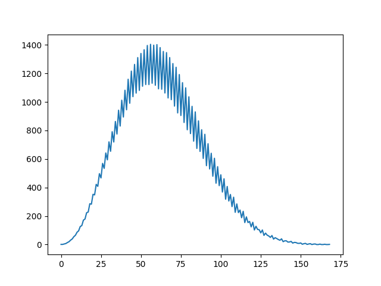
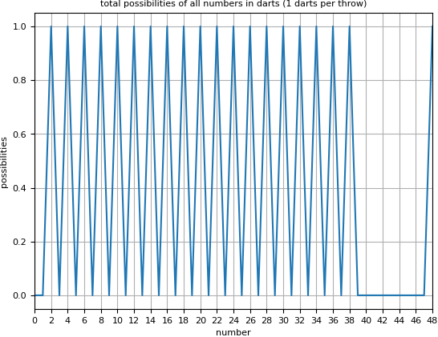
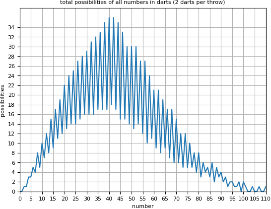
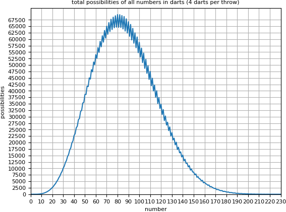
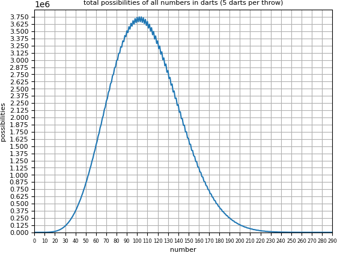

# dartcalc
Finding all possibilities checking out in darts.
## How it works 
Between 2-170 remaining points in darts you got the possibility to end the game with an amount of darts between 1-3.
Common players might not play or know to play all the calculated checkouts, they would go for the most easiest ways. 
This is just an calculating purpose (not intuitive problem).
## Plot

## Remarkable values
- `Total possibilities: 82047`
- `Most possibilities of a number (58): 1404`
- `Lowest possibilities of a number (2, 3, 156, 170): 1`
- `Bogey numbers; numbers between 2-170 but with no possibility: 159, 162, 163, 165, 166, 168, 169`
## Changing the amount of darts
### 1 darts

- `Total possibilities: 20`
- `Most possibilities of a number (2, 4, 6, 8, 10, 12, 14, 16, 18, 20, 22, 24, 26, 28, 30, 32, 34, 36, 38, 48): 1`
- `Bogey numbers; numbers between 2-170 but with no possibility: 3, 5, 7, 9, 11, 13, 15, 17, 19, 21, 23, 25, 27, 29, 31, 33, 35, 37, 39, 40, 41, 42, 43, 44, 45, 46, 47`
  
### 2 darts

- `Total possibilities: 1323`
- `Most possibilities of a number (40): 36`
- `Lowest possibilities of a number (2, 3, 93, 96, 97, 101, 104, 107, 110): 1`
- `Bogey numbers; numbers between 2-170 but with no possibility: 99, 102, 103, 105, 106, 108, 109`

### 4 darts

- `Total possibilities: 5086935`
- `Most possibilities of a number (80): 69520`
- `Lowest possibilities of a number (2, 3, 216, 230): 1`
- `Bogey numbers; numbers between 2-170 but with no possibility: 219, 222, 223, 225, 226, 228, 229`

### 5 darts

- `Total possibilities: 315389991`
- `Most possibilities of a number (102): 3750597`
- `Lowest possibilities of a number (2, 3, 276, 290): 1`
- `Bogey numbers; numbers between 2-170 but with no possibility: 279, 282, 283, 285, 286, 288, 289`
